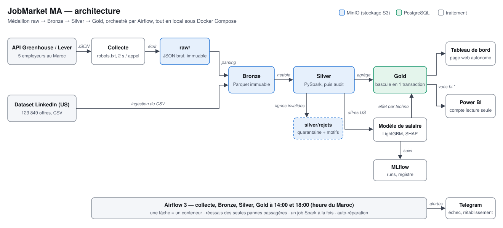
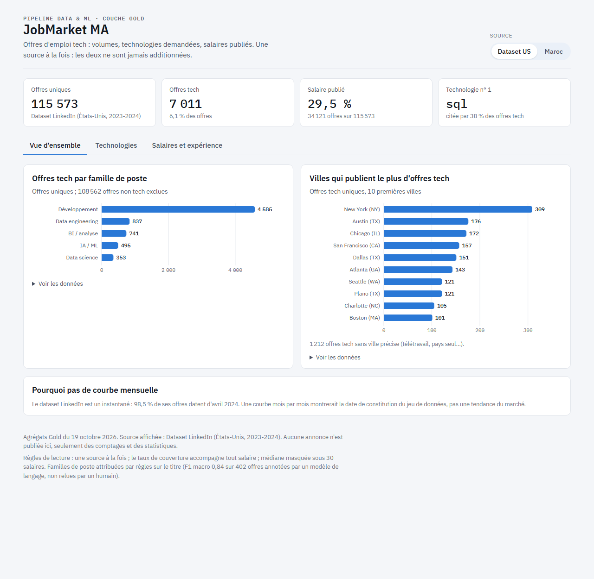

# JobMarket MA — pipeline data & ML sur le marché de l'emploi tech marocain

[](https://github.com/legssyera10-hub/Pipeline-jobmarket-ma/actions/workflows/ci.yml)


Un pipeline de bout en bout qui collecte chaque jour des offres d'emploi tech au
Maroc, les nettoie avec PySpark, contrôle leur qualité avant de les publier,
alimente un entrepôt PostgreSQL et un tableau de bord, et entraîne un modèle de
salaire suivi dans MLflow — orchestré par Airflow, entièrement en local sous Docker.

**En bref**

- Deux sources : les **API publiques de recrutement** d'employeurs au Maroc
  (Greenhouse, Lever ; collecte quotidienne à 14:00 et 18:00) et le dataset
  **LinkedIn 2023-2024** (123 849 offres US) pour développer à l'échelle.
- Architecture **médaillon** (raw → Bronze → Silver → Gold), idempotente : relancer
  un jour produit exactement le même résultat.
- **Qualité avant publication** : quarantaine ligne à ligne, puis audit Great
  Expectations ; un lot qui échoue n'est jamais publié.
- **Résilience testée** : 4 pannes provoquées, auto-réparation d'Airflow mesurée
  (service figé revenu en 4 min, sans intervention), alertes Telegram.
- **Mesures honnêtes** : chaque chiffre ci-dessous est mesuré, avec sa limite.

## Architecture



Chaque étape est un conteneur lancé par Airflow ; les données brutes et les couches
Bronze et Silver vivent dans MinIO (stockage S3), Gold dans PostgreSQL. Détail
couche par couche : [docs/fonctionnement.md](docs/fonctionnement.md).

## Chiffres

| Mesure | Valeur |
|---|---|
| Offres traitées | 123 849 offres US (115 573 uniques) ; 38 offres au Maroc, 5 employeurs, collectées 2 fois par jour |
| Runs planifiés | 8 réussis sur 9 depuis le 16/10/2026 (l'échec a conduit à corriger les runs en retard) |
| Durée | Silver sur le dataset complet : 350 à 920 s selon la charge de la machine ; run quotidien marocain : 4 à 15 min (Silver ≈ 2 min) |
| Qualité | 123 849 offres → 123 848 valides + 1 en quarantaine ; 18 contrôles critiques ; 491 résultats historisés |
| Extraction des technologies | précision **97,1 %**, rappel 92,9 % (100 offres annotées, 174 technologies) |
| Classification des familles de poste | F1 macro **0,843** (402 offres annotées ; 0,891 sur les offres marocaines) |
| Estimation du salaire (dataset US) | MAE **25 198 $**, erreur médiane 19 % ; −27 % d'erreur face à la meilleure référence naïve |
| Tests | 280 tests, couverture 63 %, CI GitHub Actions à chaque push |

Les offres marocaines ne publient **aucun** salaire (0 sur 38) : le modèle de
salaire décrit le marché américain et n'est jamais appliqué au Maroc.

## Ce que montrent les données



Le [tableau de bord web](docs/dashboard/index.html) est une page autonome générée
depuis Gold (une source à la fois, couverture des salaires toujours affichée). Sur
le dataset US : SQL (38 %) et Python (37 %) sont les plus demandés dans les offres
tech ; à profil comparable, les offres qui citent Python ou GCP sont estimées
environ 9 % et 8 % plus haut (association, pas causalité).

| | |
|---|---|
|  |  |

## Démarrage rapide

Prérequis : Docker Desktop (Python, Java et Spark tournent dans les conteneurs).

```bash
cp .env.example .env                       # mots de passe et secrets à remplir
docker compose --profile tools build app
docker compose up -d                       # MinIO, PostgreSQL, Airflow, MLflow
docker compose run --rm app python -m scripts.check_infra      # 6/6 attendus
docker compose run --rm --no-deps app pytest -q                # 280 tests

# Données : placer le dataset Kaggle dans data/raw/, puis le traiter
# (les DAGs sont créés en pause : on les active délibérément)
docker compose exec airflow-scheduler airflow dags unpause kaggle_manuel
docker compose exec airflow-scheduler airflow dags trigger kaggle_manuel
docker compose run --rm --no-deps app python -m scripts.tableau_de_bord
```

Interfaces (sur ce poste uniquement) : Airflow http://localhost:8080, MLflow
http://localhost:5000, console MinIO http://localhost:9001.

## Décisions et compromis

Les 62 décisions, avec leur contexte, sont dans
[docs/decisions.md](docs/decisions.md). Les plus structurantes :

**API publiques de recrutement plutôt que les grands sites d'emploi marocains.**
ReKrute interdit les agrégateurs et Emploi.ma est protégé contre les robots ; les
API Greenhouse et Lever sont publiques et prévues pour ça. Coût : un échantillon
(5 employeurs, 38 offres), pas le marché marocain entier.

**Réponses brutes et Bronze immuables plutôt que réécrits.** Les JSON sont gardés
tels quels et Bronze refuse d'écraser une date déjà ingérée (écriture
conditionnelle). Un changement de format d'API se corrige en rejouant le parsing,
sans rappeler l'API. Coût : du stockage en plus et un nettoyage manuel en cas de
vraie erreur d'ingestion.

**Republications marquées sur 30 jours plutôt que supprimées.** Une annonce
republiée est un signal (poste difficile à pourvoir) ; elle est marquée, comptée à
part (`nb_annonces`) et exclue des offres uniques. Coût : deux compteurs à
expliquer dans chaque table.

**Regex et référentiel plutôt qu'un modèle de NER pour les technologies.**
Précision 97,1 % et rappel 92,9 % mesurés, pour une fraction du coût. Limite : les
écritures inattendues (`HTML5`, `Springboot`) passent au travers et le référentiel
se maintient à la main.

**Contrôle qualité avant publication plutôt qu'après.** Silver est écrit à côté,
audité par Great Expectations, puis publié seulement si les contrôles critiques
passent ; sinon la version précédente reste en place. Coût : un job plus long et
un espace temporaire.

**Une tâche Airflow = un conteneur, et des codes de sortie.** Airflow ne fait
qu'ordonnancer l'image des tests. Seules les pannes passagères sont réessayées ; un
changement de format ou un lot refusé échoue tout de suite et alerte. Coût :
démarrage d'un conteneur par tâche (quelques secondes).

**Découpage par entreprise pour évaluer le modèle de salaire.** Une entreprise
publie des annonces quasi identiques ; un découpage aléatoire gonfle le score.
Le test ne contient que des entreprises jamais vues. Coût : un score plus bas,
mais honnête.

**Tout en local (MinIO, PostgreSQL) plutôt que dans le cloud.** Apprendre
l'architecture avant l'IAM, sans facture. Coût : une migration à prévoir
(authentification, connecteurs) et une machine locale qui devient le point faible
(voir ci-dessous).

## Incidents et résilience

Pannes **provoquées volontairement** sur une source isolée, pour ne jamais
corrompre les vraies données :

| Panne | Comportement | Résultat |
|---|---|---|
| MinIO coupé 4 min pendant Silver | le client S3 de Spark réessaie seul | succès à la 1re tentative, aucun doublon |
| Format d'API modifié | Bronze échoue en 90 s, sans réessai, message explicite | alerte ; réponses brutes conservées, parsing rejouable |
| Contrôle qualité en échec | Silver « NON PUBLIÉ », Gold ne tourne pas | alerte ; version précédente intacte, trace en base |
| Tâche bloquée | réessai 2 min plus tard | succès à la 2e tentative, alerte « rétabli » |

Incidents **réels**, et ce qui a changé :

- **Planificateur Airflow figé 35 min** sur une machine à court de mémoire : un
  run aurait été perdu. Docker ne relance pas un service « malsain » ; un contrôle
  de santé auto-réparateur arrête désormais le service figé et Docker le relance
  (testé : 4 min, alerte Telegram).
- **Run planifié rattrapé le lendemain** (PC éteint) : la collecte refusait la date
  passée et alertait à tort. Un run en retard rejoue maintenant le parsing sans
  rappeler l'API et envoie une simple information.
- **Lenteurs de 2 à 4 fois** : cause trouvée côté hôte (Windows paginait la
  machine virtuelle de Docker), pas dans le code. Mesures et réglages documentés
  (journal, jour 8).

## Limites connues

- **La source marocaine est petite** (38 offres, 5 employeurs) et ne publie aucun
  salaire : elle illustre le pipeline réel, elle ne décrit pas le marché marocain.
- **Le dataset US est un instantané** (98,5 % des offres en avril 2024) : pas de
  tendance dans le temps, d'où l'absence de courbe mensuelle.
- **Les annotations ont été posées par un modèle de langage**, pas par un humain
  (protocole et limites : [décision D61](docs/decisions.md)). Une relecture humaine
  d'un échantillon renforcerait les deux mesures.
- **Les règles de famille de poste confondent** certaines offres non tech (emplois
  d'annotation titrés « Data Analyst ») avec de la BI ; correction à faire sur un
  jeu de validation séparé.
- **Le modèle de salaire reste imprécis** (erreur médiane 19 %) et ses effets par
  technologie sont des associations.
- **Tout tourne sur un seul PC** : s'il est éteint à 14:00 et à 18:00, la journée
  de collecte est perdue (une API ne donne que l'état du jour). Des arrêts de
  processus PostgreSQL sous forte charge restent sans cause prouvée.
- **Le tableau de bord Power BI est spécifié** ([guide](docs/powerbi.md)) mais pas
  construit ; le tableau de bord web le remplace.

## Pour aller plus loin

| Document | Contenu |
|---|---|
| [docs/fonctionnement.md](docs/fonctionnement.md) | chaque couche en détail : commandes, tables, contrôles |
| [docs/decisions.md](docs/decisions.md) | 62 décisions : raison, alternative, coût |
| [docs/journal.md](docs/journal.md) | le projet jour par jour, erreurs comprises |
| [docs/powerbi.md](docs/powerbi.md) | guide du tableau de bord Power BI |
| [docs/guide_annotation.md](docs/guide_annotation.md) | grille d'annotation des familles de poste |

Le dépôt ne contient que du code et des agrégats : aucune annonce n'y est publiée
(le dataset et les fichiers d'annotation restent hors du dépôt).
