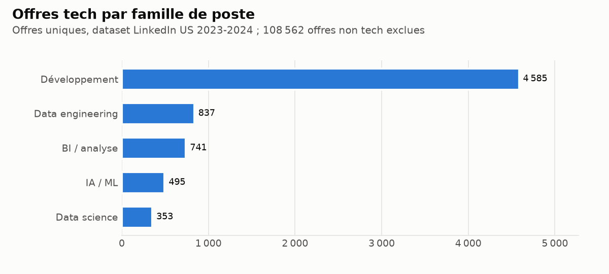
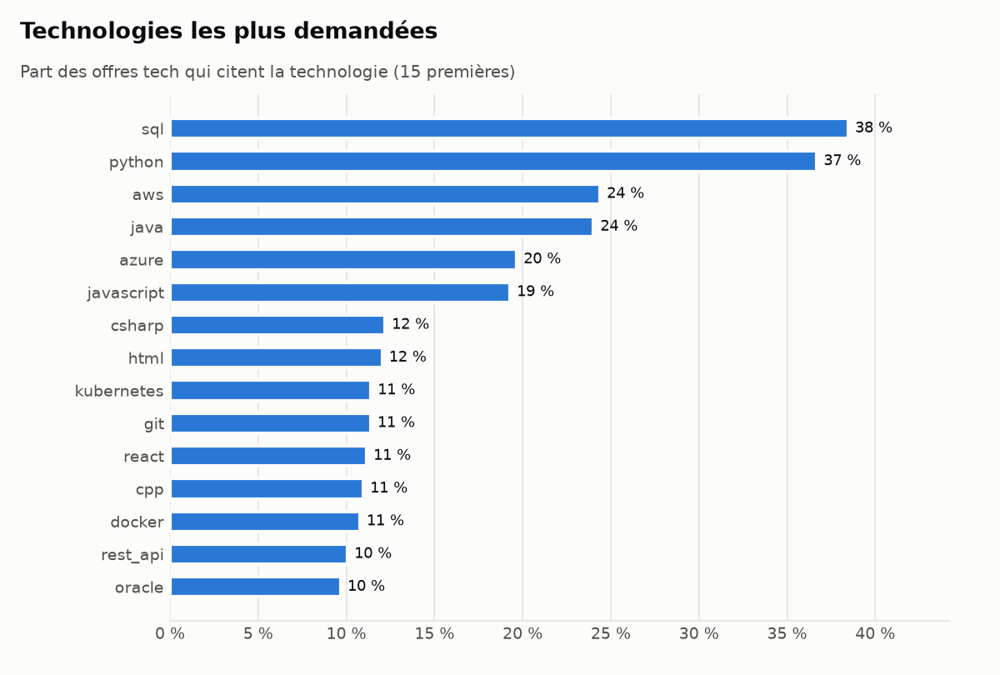
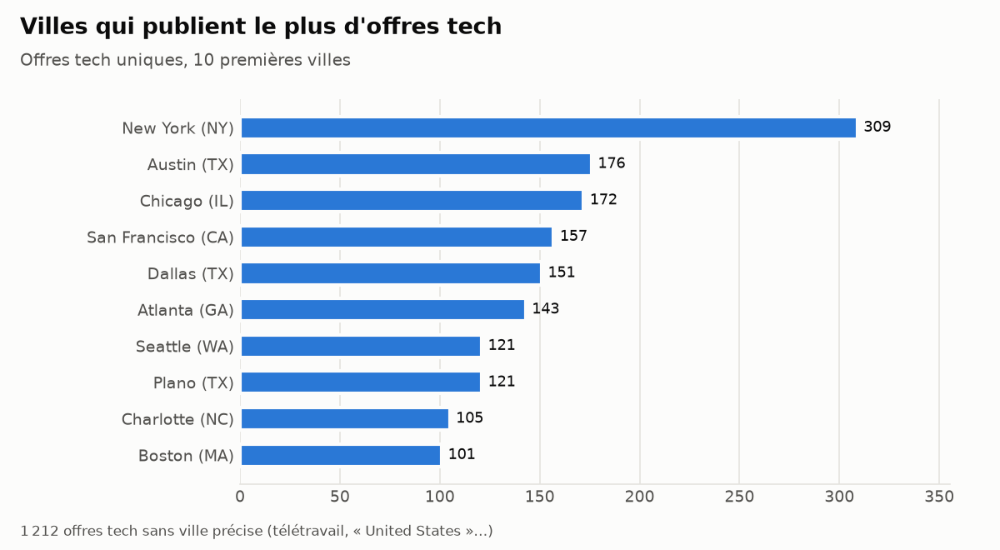
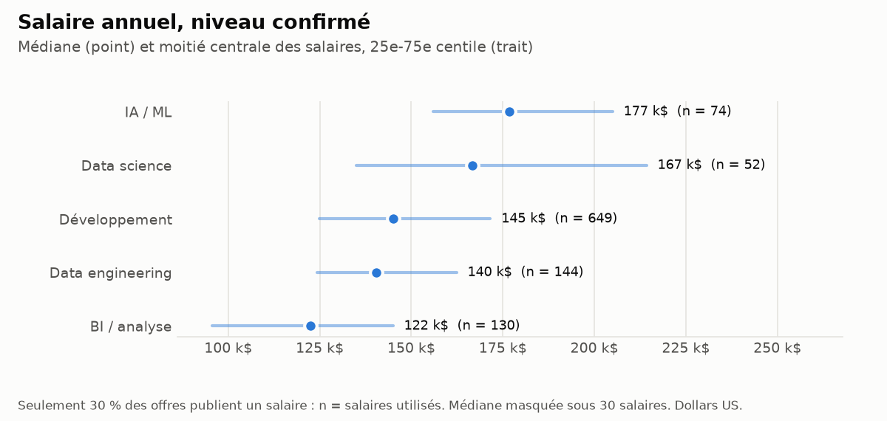
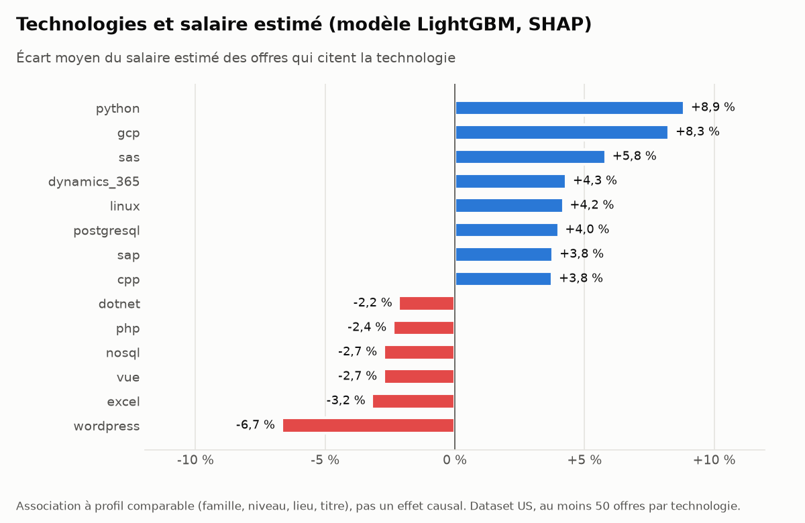

# Fonctionnement détaillé

Référence technique de JobMarket MA, couche par couche. Vue d'ensemble, chiffres et
décisions : [README](../README.md). Choix argumentés : [decisions.md](decisions.md) ;
récit jour par jour : [journal.md](journal.md).

## Sources

| Source | Contenu | Volume |
|---|---|---|
| `ats_maroc` | offres **au Maroc** publiées par des employeurs via les API publiques de leurs logiciels de recrutement (Greenhouse, Lever) | 38 offres uniques au 2026-10-20 (37 au premier jour), 5 employeurs |
| `kaggle_linkedin` | dataset « LinkedIn Job Postings 2023-2024 » (États-Unis), source de développement | 123 849 offres |

**Limite assumée :** `ats_maroc` est un échantillon (conseil, startups, quelques
employeurs), **pas** le marché marocain dans son ensemble. Les grands sites marocains
ont été écartés après lecture de leur robots.txt et de leurs conditions d'utilisation
(ReKrute interdit les agrégateurs, Emploi.ma est protégé par Cloudflare…). Analyse
complète : [docs/journal.md](journal.md), jour 6.

### Collecte des offres marocaines

```bash
docker compose run --rm app python -m src.ingestion.ats.collecte          # aujourd'hui
docker compose run --rm app python -m src.ingestion.run --source ats_maroc --date AAAA-MM-JJ
docker compose run --rm --no-deps app python -m scripts.sonder_employeurs <slug>
```

Règles de collecte, appliquées par un client HTTP unique
([src/ingestion/ats/http.py](../src/ingestion/ats/http.py)) :

- `robots.txt` lu avec Protego et respecté, `Crawl-delay` compris ;
- au moins 2 s entre deux appels au même hôte, aucun parallélisme ;
- User-Agent identifiable (`COLLECTE_CONTACT` dans `.env`) ;
- réessais espacés sur les erreurs 429 et 5xx.

Les réponses JSON sont stockées **brutes et immuables** (`raw/`). Le parsing se
rejoue sans réseau. Une API donne l'état du jour : la collecte refuse toute date
passée. Chaque jour, l'API renvoie les offres encore ouvertes : Silver ne publie une
offre qu'une fois, et chaque présence quotidienne est conservée dans
`silver/observations` (pour mesurer à terme la durée de mise en ligne).

## Ingestion Bronze (dataset Kaggle)

Dataset à placer dans `data/raw/` (non versionné : on ne republie pas les annonces).

```bash
docker compose run --rm app python -m src.ingestion.run --all              # backfill
docker compose run --rm app python -m src.ingestion.run --date 2024-04-09  # un jour
docker compose run --rm app python -m scripts.check_bronze                 # contrôles
```

`bronze/source=<source>/date=<YYYY-MM-DD>/data.parquet` : colonnes source en texte et
colonnes techniques `_ingested_at`, `_source`, `_run_date`. **Immuable** : une date
déjà ingérée est ignorée (écriture conditionnelle `If-None-Match`).

## Couche Silver (PySpark)

```bash
docker compose run --rm app python -m src.transform.silver --all [--explain]
docker compose run --rm app python -m src.transform.silver --date 2024-04-09
docker compose run --rm app python -m scripts.check_silver                 # contrôles
```

`silver/offres/source=<source>/date_collecte=<YYYY-MM-DD>/` : une ligne par offre,
typée et enrichie.

- `offre_id` : SHA-256 de la source et de l'URL sans paramètre de suivi.
- Titre, entreprise et ville normalisés ; état et région résolus par jointure
  broadcast avec `reference/`.
- Famille de poste (règles provisoires) et technologies (174 entrées dans
  `reference/technologies.yaml`).
- Années d'expérience, salaire annualisé, type de contrat, télétravail.
- `est_republication` : même entreprise, titre et ville dans les 30 jours
  précédents (fenêtre glissante, marquage sans suppression).

| Chiffres (run complet) | |
|---|---|
| Offres Bronze -> Silver | 123 849 -> 123 848 valides + 1 rejet, `offre_id` unique |
| Durée (dataset complet) | 350 s au jour 5, 908-920 s au jour 6 : due très probablement à la pagination de l'hôte Windows à court de RAM (journal, jour 8) ; `ats_maroc` : 43 s |
| Offres tech avec au moins une technologie détectée | 90,2 % |
| Salaire annualisé concordant avec la source | 100 % (29 % des offres ont un salaire) |
| Extraction des technologies (100 offres annotées) | précision 97,1 %, rappel 92,9 %, F1 95,0 % |

## Qualité des données

Deux niveaux de règles ligne à ligne ([src/quality/rules.py](../src/quality/rules.py)) :

- **bloquantes** (identifiant, titre ou date de publication manquants, publication
  après la collecte) : l'offre part en quarantaine dans `silver/rejets` avec **tous**
  ses motifs. Aucune ligne n'est perdue ;
- **anomalies** (salaire hors bornes ou incohérent, devise non USD, expiration avant
  publication) : l'offre reste valide, le motif est listé dans `_anomalies`.

Puis une validation du lot par Great Expectations
([src/quality/expectations.py](../src/quality/expectations.py)), selon le motif
**write-audit-publish**. Si un contrôle critique échoue (doublon d'`offre_id`, valeur
hors référentiel, dérive d'un taux de remplissage, taux de rejet supérieur à 5 %),
Silver n'est **pas publié**, la version précédente reste en place et le job sort avec
le code 1. Chaque résultat est historisé dans `ops.controles_qualite`.

```bash
docker compose run --rm app python -m scripts.demo_corruption   # démonstration
```

La démonstration injecte 50 lignes corrompues et une dérive de format dans une source
isolée. Elle vérifie qu'elles sont en quarantaine avec le bon motif, que la
validation échoue et que rien n'est publié, puis elle nettoie.

| Chiffres (run complet) | |
|---|---|
| Bronze -> Silver | 123 849 = 123 848 valides + 1 rejet |
| Contrôles critiques | 18/18 réussis |
| Salaires signalés en anomalie (hors bornes) | 495 (1,4 % des salaires) |

## Couche Gold (PostgreSQL)

```bash
docker compose run --rm app python -m src.transform.gold
docker compose run --rm --no-deps app python -m scripts.check_gold
```

| Table | Contenu |
|---|---|
| `gold.tech_par_mois` | technologie x mois x périmètre (toutes / tech) : offres, annonces, part |
| `gold.offres_par_ville` | mois x ville x état x famille de poste |
| `gold.experience_demandee` | famille de poste x tranche d'expérience, part dans la famille |
| `gold.cooccurrence_tech` | paires de technologies : offres communes, Jaccard, lift |
| `gold.prime_salariale_tech` | effet associé de chaque technologie sur le salaire (modèle ML, dataset US) |
| `gold.salaires_par_famille` | famille x niveau : taux de couverture des salaires, quartiles en USD |

`nb_offres` compte les offres uniques (hors republications), `nb_annonces` toutes les
annonces. Le recalcul est complet, écrit dans `gold_staging` puis basculé en une seule
transaction : un lecteur ne voit jamais d'état intermédiaire. Relancer le job produit
des tables identiques (empreintes MD5 comparées).

## Orchestration (Airflow 3)

| DAG | Planification | Étapes |
|---|---|---|
| `ats_maroc_quotidien` | **14:00** et **18:00**, heure du Maroc | choisir → collecte → bronze → silver → gold |
| `kaggle_manuel` | à la demande | bronze → silver → gold (retraitement du dataset) |
| `ml_manuel` | à la demande | modèle de salaire : entraînement, MLflow, SHAP, imputation |

- **Chaque tâche est un conteneur `jobmarket-app`**, la même image que les tests.
  Airflow ne fait qu'ordonnancer : aucune dépendance du pipeline n'est installée
  dans l'image Airflow.
- **14:00 / 18:00** : à 14:00, si un employeur échoue, la journée n'est pas figée
  (Bronze est immuable). À 18:00 (rattrapage), seuls les manquants sont rappelés,
  puis la journée est traitée avec ce qui a été collecté.
- **Idempotence** : la date traitée vient de la date logique (`{{ ds }}`), jamais
  de `now()` ; Bronze est immuable ; Silver remplace ses partitions ; Gold bascule
  en une transaction. Relancer un run produit le même résultat.
- **Réessais** : 3, espacés de 2, 4 puis 8 minutes, **uniquement pour les pannes
  passagères** (code de sortie 1). Une erreur déterministe (format d'API modifié,
  données refusées par la qualité, date vide : code 3) échoue tout de suite.
- **Alertes Telegram** : échec définitif (avec les dernières lignes du log) et
  rétablissement après un échec. La collecte alerte aussi quand elle est partielle.
- **Mémoire** : un seul job Spark à la fois (pool `spark`).
- **Auto-réparation** : Docker ne redémarre pas un service « unhealthy ». Le
  contrôle de santé du scheduler et de l'api-server
  ([docker/airflow/autoheal.py](../docker/airflow/autoheal.py)) arrête le conteneur
  après ~3 min de blocage ; Docker le relance et une alerte Telegram le signale.
  Testé en gelant le scheduler : revenu en 4 min, sans intervention.

```bash
# Rejouer un jour sans rappeler les API (les réponses brutes sont conservées) :
docker compose exec airflow-scheduler airflow dags trigger ats_maroc_quotidien \
    --conf '{"collecter": false, "date": "2026-10-16"}'
# Vérifier les DAGs (24 contrôles, exécutés dans l'image Airflow) :
docker compose run --rm --no-deps -v ./tests/airflow:/opt/airflow/verif \
    airflow-scheduler python /opt/airflow/verif/verifier_dags.py
```

Sous Git Bash (Windows), préfixer par `MSYS_NO_PATHCONV=1` et remplacer
`./tests/airflow` par `"$(pwd -W)/tests/airflow"`.

## Couche ML (MLflow)

### Estimation du salaire

```bash
docker compose run --rm app python -m src.ml.salaire     # ou le DAG ml_manuel
```

**Données : le dataset américain (USD), pas le Maroc.** Aucune des offres
marocaines ne publie de salaire : un modèle marocain ne peut être ni entraîné ni
évalué. Le modèle décrit le marché du dataset de développement et n'est jamais
appliqué aux offres marocaines.

- Cible : log du milieu de la fourchette ; salaires en anomalie, devises non USD et
  republications exclus.
- Découpage **par entreprise** (`GroupShuffleSplit`) : le test ne contient que des
  entreprises jamais vues, sinon les annonces quasi identiques d'une même
  entreprise gonfleraient le score.
- 5 configurations suivies dans MLflow ; la meilleure est enregistrée dans le
  registre (`salaire_annuel_usd`), au format `skops` (sans pickle).

| Configuration (test : 7 523 offres, 2 033 entreprises inconnues) | MAE | Erreur médiane | R² (log) |
|---|---|---|---|
| Médiane globale (référence) | 42 341 $ | 33 280 $ (40 %) | 0,00 |
| Médiane par famille × niveau (référence) | 34 342 $ | 23 420 $ (29 %) | 0,26 |
| LightGBM sans titre | 30 289 $ | 19 859 $ (26 %) | 0,44 |
| LightGBM avec titre (TF-IDF → SVD) | 25 588 $ | 15 459 $ (20 %) | 0,58 |
| **LightGBM avec titre, régularisé (retenu)** | **25 198 $** | **15 178 $ (19 %)** | **0,59** |

Soit **−27 % d'erreur** par rapport à la meilleure référence naïve. Le titre est la
variable qui apporte le plus. 80 940 salaires manquants sont estimés dans
`ml/predictions/salaire/` (médiane 74 600 $).

**Technologies et salaire (SHAP)** — effet moyen sur les offres qui citent la
technologie, à famille, niveau, lieu et titre comparables (au moins 50 offres
d'entraînement) : Python +8,9 %, GCP +8,3 %, SAS +5,8 %, Linux +4,2 % ; Excel
−3,2 %, WordPress −6,7 %. **C'est une association, pas un effet causal** : apprendre
Python ne fait pas gagner 8,9 %. Les 74 technologies sont dans
`gold.prime_salariale_tech`, avec le `mlflow_run_id` du modèle.

### Familles de poste : règles contre modèles

Les familles viennent aujourd'hui de règles sur le titre. Pour les mesurer, puis les
comparer à TF-IDF + régression logistique (et sentence-transformers), il faut une
**vérité terrain annotée à la main** : entraîner un modèle sur les sorties des règles
ne lui apprendrait qu'à les imiter.

```bash
docker compose run --rm app python -m src.ml.classification echantillon  # 402 offres
# annoter data/annotation/familles.csv (guide : docs/guide_annotation.md)
docker compose run --rm --no-deps app python -m src.ml.classification evaluer
```

Résultats sur 402 offres annotées (37 marocaines, 365 du dataset US) :

| Méthode | F1 macro | Hors cas ambigus (344) | Maroc (37) |
|---|---|---|---|
| **Règles actuelles sur le titre** | **0,843** | **0,904** | **0,891** |
| TF-IDF + régression logistique (validation croisée) | 0,770 | 0,817 | 0,370 |

Les règles restent en place : avec 402 exemples, le modèle fait moins bien, et
s'effondre sur les offres marocaines (en français, peu nombreuses dans
l'entraînement). Point faible des règles : la classe « non tech » (rappel 0,58) ;
des emplois d'annotation de données ou de saisie titrés « Data Analyst » passent
pour de la BI. Correction à faire sur un jeu de validation séparé, pas sur celui
qui sert à mesurer.

**Limite :** les étiquettes ont été posées par un modèle de langage (Claude),
pas par un humain, en suivant [docs/guide_annotation.md](guide_annotation.md),
sans voir la prédiction des règles ; 58 offres ambiguës sont marquées. Comme les
règles, cet annotateur lit d'abord le titre : l'accord peut être un peu
surestimé. Une relecture humaine d'un échantillon est recommandée.

## Restitution

### Tableau de bord web

[docs/dashboard/index.html](dashboard/index.html) : une page autonome (sans
serveur) générée depuis les agrégats Gold par
`python -m scripts.tableau_de_bord`. Trois onglets (vue d'ensemble, technologies,
salaires et expérience), une source à la fois, info-bulles, données de chaque
graphique consultables en tableau, thèmes clair et sombre. Mêmes règles que le
guide Power BI : couverture affichée avec tout salaire, médiane masquée sous 30
salaires.

### Power BI et figures

Le tableau de bord Power BI lit les tables Gold et les vues `bi.*` avec un compte
PostgreSQL **en lecture seule** : connexion, mesures et contenu des 3 pages dans
[docs/powerbi.md](powerbi.md). Les figures ci-dessous en sont l'aperçu,
générées depuis les mêmes agrégats par `python -m scripts.figures_readme`
(dataset LinkedIn US ; la source marocaine, 38 offres, est trop petite pour ces
graphiques).







Règles de lecture appliquées partout :

- **une source à la fois**, jamais le dataset US additionné aux offres marocaines ;
- **la couverture accompagne toujours un salaire** : 29,5 % des offres US publient
  un salaire, 0 % des offres marocaines ; une médiane sur moins de 30 salaires
  est masquée ;
- **pas de courbe mensuelle** tant que les données ne la justifient pas : le
  dataset US est un instantané (98,5 % des offres en avril 2024).

## Intégration continue

[.github/workflows/ci.yml](../.github/workflows/ci.yml), à chaque push et pull
request, sans secret ni service :

- **qualité et tests** : ruff, black, tous les tests (dont Spark local, Java 17),
  couverture 63 % avec un seuil à 60 % ;
- **DAGs** : image Airflow du projet construite, puis vérification des DAGs sans
  base de données ni réseau (24 contrôles).

## Sécurité

- Aucun secret dans le dépôt ni dans son historique : les valeurs réelles de
  `.env` ont été recherchées dans tous les commits (0 occurrence).
- Tous les services n'écoutent que sur `127.0.0.1` (ce PC).
- Power BI se connecte avec `powerbi_lecteur`, qui ne peut que lire `gold` et `bi`.
- Le dépôt ne contient que du code et des agrégats : ni annonce, ni fichier
  d'annotation (`data/` est exclu).

## Incidents et résilience

Pannes **provoquées volontairement** le 2026-10-16, sur une source isolée
(`ats_maroc_demo`, préparée par `scripts/preparer_incident.py`) pour ne jamais
corrompre les vraies données :

| Panne | Ce qui se passe | Résultat |
|---|---|---|
| **MinIO coupé 4 minutes pendant `silver`** | Le client S3 de Spark réessaie seul ; la tâche reste « en cours » et reprend au retour de MinIO (étape de construction : 269 s au lieu d'environ 2 min). | Succès à la **1re tentative**, 37 offres, aucun doublon, rien en transit |
| **Une source change de format** (Lever : `text` devient `title`) | `bronze` échoue en 90 s, **sans réessai** : « 'text' absent de 127/127 offres… corriger le parseur puis rejouer raw -> Bronze ». Silver et Gold ne s'exécutent pas. | Alerte Telegram ; réponses brutes conservées, parsing rejouable |
| **La validation échoue** (plus aucune ville reconnue) | `silver` : `ville_normalisee` vide à 100 %, contrôle critique en échec, **« NON PUBLIÉ »**. Gold ne s'exécute pas. | Alerte ; Silver garde sa version précédente ; lot refusé en transit ; trace dans `ops.controles_qualite` |
| **Panne passagère d'une tâche** (Spark bloqué, conteneur arrêté) | Réessai automatique 2 minutes plus tard | Succès à la 2e tentative, alerte « ✅ rétabli » |

Ce que ces pannes ont révélé, et qui a été corrigé :

- Spark ne démarrait pas sous Airflow (envoi interne d'un jar de 280 Mo), et le
  processus **ne se terminait pas** après l'erreur : la tâche serait restée bloquée
  30 minutes. Jars mis sur le classpath ; tout job en échec se termine désormais
  avec un code de sortie (`src/utils/cli.py`).
- Les erreurs déterministes étaient réessayées 3 fois : l'alerte arrivait avec
  environ 15 minutes de retard. Convention de codes de sortie (0/1/2/3).
- Une date sans données était considérée comme une panne passagère : elle est
  maintenant non réessayée.

Si le PC est éteint à 14:00 **et** à 18:00, la journée de collecte est perdue :
une API ne donne que l'état du jour. Le parsing, lui, peut toujours être rejoué.

## Organisation du dépôt

```
src/ingestion/    collecteurs, collecte des API (ats/), écriture Bronze
src/transform/    jobs PySpark Silver / Gold
src/quality/      règles de quarantaine, suites Great Expectations
src/ml/           modèle de salaire (LightGBM, SHAP), classification des familles
src/utils/        config (.env), SparkSession (s3a + JDBC), client S3, PostgreSQL
sql/              schéma PostgreSQL (gold, gold_staging, ops, vues bi), idempotent
scripts/          scripts opérationnels (check_*, figures, tableau de bord web, rôle Power BI, annotation)
dags/             DAGs Airflow (+ commun.py : tâche = conteneur, alertes)
reference/        référentiels (technologies, états US, villes marocaines, employeurs)
tests/            tests unitaires (+ fixtures), vérification des DAGs (airflow/)
.github/          CI GitHub Actions
docker/           Dockerfiles (app, Airflow, MLflow), auto-réparation, init SQL
docs/             décisions, journal, guides (annotation, Power BI), figures (img/), tableau de bord (dashboard/)
```
